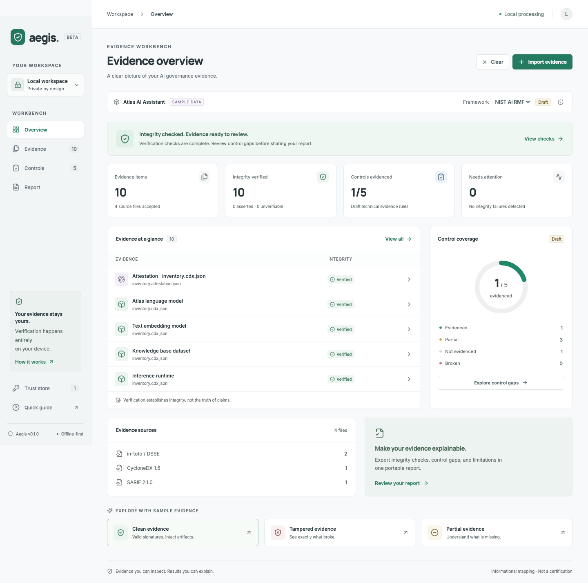
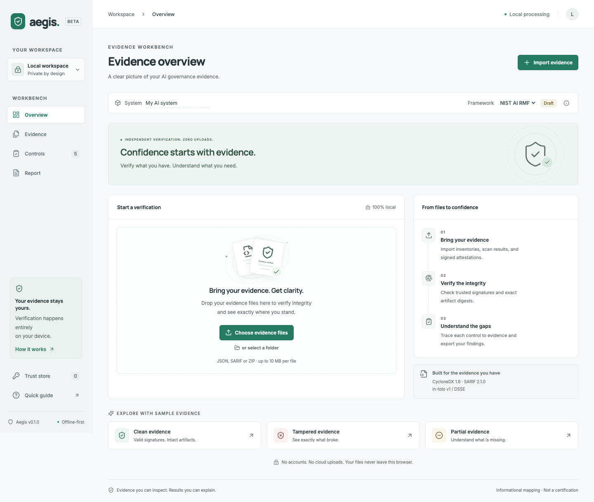
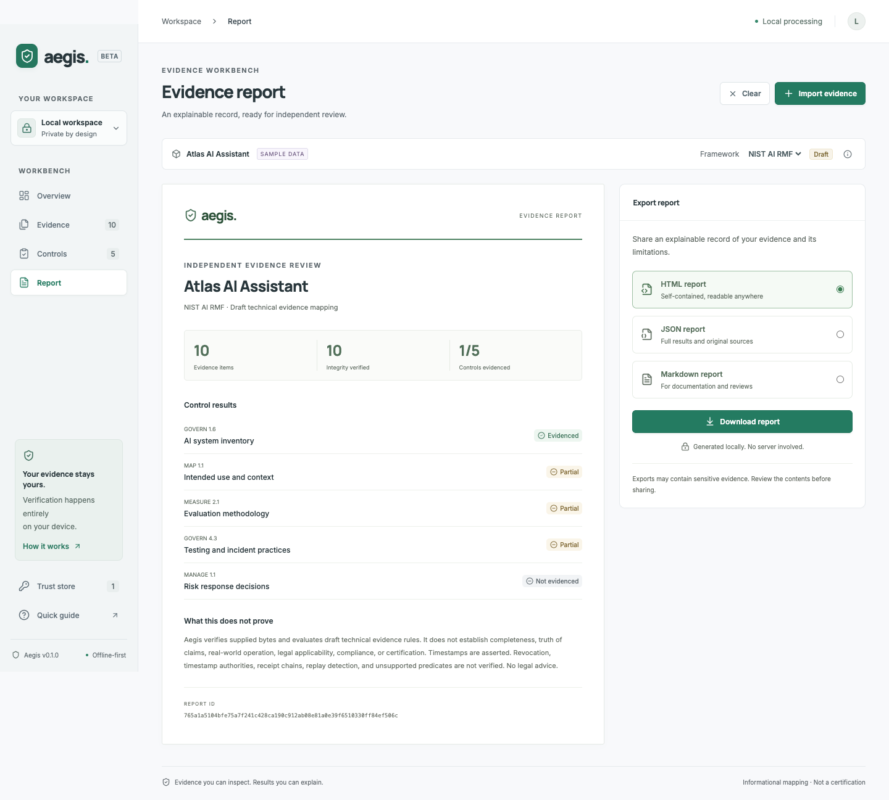
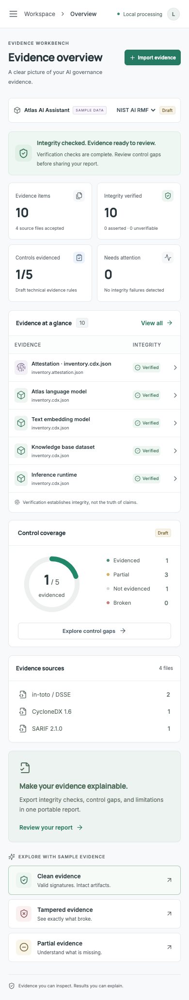

<div align="center">

# Aegis

### Private, explainable verification for AI governance evidence

Import evidence, verify signatures and artifact digests, trace draft control
mappings, and export a review-ready report—entirely on your device.

[](crates/aegis-core)
[](web/verifier)
[](crates/aegis-wasm)
[](docs/architecture.md)
[](LICENSE)

[Get started](#run-locally) · [Try the upload example](examples/aegis-upload-demo) · [Architecture](docs/architecture.md) · [Validation](docs/validation.md)

</div>



## Why Aegis

Aegis is an offline AI governance evidence workbench with one deterministic Rust
engine shared by its CLI and browser app. The React interface runs that engine as
WebAssembly inside a Web Worker, so evidence never needs to reach a hosted backend.

| Local by design | Evidence-aware | Explainable output |
| --- | --- | --- |
| No account, cloud upload, or hosted API | CycloneDX, SARIF, in-toto and DSSE | Every result links to its source and check |
| Files and public keys remain in memory | Ed25519 signatures and SHA-256 subjects | JSON, Markdown and standalone HTML reports |
| Works offline after first production load | Explicit trust store—never implicit trust | Draft NIST AI RMF and EU AI Act mappings |

## Product tour

| Import evidence | Review the report |
| :---: | :---: |
|  |  |

<details>
<summary><strong>View the responsive mobile interface</strong></summary>
<br>
<p align="center">
  
</p>
</details>

## How it works

```text
Evidence files / ZIP
        │
        ▼
 React + TypeScript UI ──► Web Worker ──► Rust engine (WASM)
        │                                      │
        │                                      ├─ Parse and normalize
        │                                      ├─ Verify signatures + digests
        │                                      └─ Map evidence to controls
        │
        └──────────── Explainable report ◄─────┘
                       HTML · JSON · Markdown
```

The browser and CLI use the same core analysis model. That keeps results portable,
testable, and consistent across interactive and automated workflows.

## Frontend snippets

The UI keeps verification off the main thread and communicates with the WASM engine
through a small promise-based worker boundary:

```ts
function call(action: string, value: unknown, format?: string) {
  if (!worker) {
    worker = new Worker(new URL('./engine.worker.ts', import.meta.url), {
      type: 'module',
    });

    worker.onmessage = ({ data }) => {
      const request = pending.get(data.id);
      if (!request) return;
      pending.delete(data.id);
      data.error
        ? request.reject(new Error(data.error))
        : request.resolve(data.result);
    };
  }

  return new Promise((resolve, reject) => {
    const id = ++sequence;
    pending.set(id, { resolve, reject });
    worker!.postMessage({ id, action, value, format });
  });
}
```

Inside the worker, inputs cross the WASM boundary as deterministic JSON and results
return to React without blocking drag-and-drop, navigation, or filtering:

```ts
import init, { analyze, render } from './wasm/aegis_wasm';
import wasmUrl from './wasm/aegis_wasm_bg.wasm?url';

const ready = init({ module_or_path: wasmUrl });

self.onmessage = async ({ data }) => {
  try {
    await ready;
    const result = data.action === 'analyze'
      ? JSON.parse(analyze(JSON.stringify(data.value)))
      : render(JSON.stringify(data.value), data.format);
    self.postMessage({ id: data.id, result });
  } catch (error) {
    self.postMessage({ id: data.id, error: String(error) });
  }
};
```

See the complete implementation in [`web/verifier/src`](web/verifier/src).

## Run locally

Prerequisites: Rust stable, the `wasm32-unknown-unknown` target, Node.js 22+, npm, and wasm-pack.

```sh
rustup target add wasm32-unknown-unknown
cargo install wasm-pack --locked
npm run setup
npm run dev
```

Open **http://127.0.0.1:5173**. Choose **Clean evidence** for a real signed demonstration, **Tampered evidence** for broken signatures and subject digests, or **Partial evidence** for missing files and unknown trust. Sample runs use an explicitly labeled public test key.

For a file-upload test, use [`examples/aegis-upload-demo/aegis-example-evidence.zip`](examples/aegis-upload-demo/aegis-example-evidence.zip), then import the adjacent `trust-store.json` from the sidebar. The example's README contains the expected results.

For an offline-capable production build:

```sh
npm run build
npm run preview
```

Open **http://127.0.0.1:4173** once while online. A service worker caches only the application assets. After installation, reload offline and verify evidence. Development mode does not install the offline cache. Evidence, keys, and results are kept in memory and cleared on reload or reset.

## CLI quickstart

```sh
cargo run -p aegis-cli -- inspect fixtures/clean
cargo run -p aegis-cli -- verify fixtures/clean --trust-store fixtures/demo-trust-store.json
cargo run -p aegis-cli -- report fixtures/clean --trust-store fixtures/demo-trust-store.json --framework nist-ai-rmf --format html -o /tmp/aegis-report.html
```

The last command writes a report and exits **1**, because the clean sample has control gaps. Clean integrity does not mean all technical evidence requirements are present.

Commands: `inspect`, `verify`, `map`, `report`, `mappings list`, `schema evidence|mapping|report|request|trust-store`. Input may be a file, directory, or ZIP. Global flags: `--strict`, `--json`, `--no-color`, `--quiet`. The CLI uses plain output without ANSI colors. `--strict` makes asserted evidence a verification gap. `--json` returns structured results for inspect/verify/map; report's `--format` controls its output.

Exit codes, in precedence order:

| Code | Meaning |
| --- | --- |
| 3 | Usage/input error or rejected files |
| 2 | Integrity failure |
| 1 | Unverifiable evidence, strict-mode assertions, or mapping gaps |
| 0 | Selected operation succeeded |

`inspect` succeeds for readable, supported inputs regardless of verification outcomes. `verify` succeeds if there are no failed or unresolved checks (unsigned assertions are permitted unless strict). `map` and `report` also require every included technical rule to be evidenced. Reports remain available when gaps or integrity failures are found.

## Supported evidence

- **CycloneDX 1.6 JSON:** structural parsing of components and model-card metadata.
- **SARIF 2.1.0:** structural parsing of tools, run summaries, and findings.
- **in-toto Statement v1 / DSSE:** original payload-byte verification with Ed25519 and explicit imported trust; SHA-256 subjects checked against supplied files. Predicates are preserved without semantic interpretation.

Format detection is content based. These are bounded structural adapters, not complete validators for every optional field in the upstream schemas. Unsupported versions and malformed required structures are reported. A successful scan-file signature does not mean its findings are resolved.

Import the folder containing the attestation subject paths as its root, or put those paths at the ZIP root. Folder picker imports remove only the selected folder's outer name. An attestation for `inventory.cdx.json` must receive that exact relative path. Unreferenced arbitrary files are rejected; binary subject artifacts are accounted for without creating synthetic evidence items.

Trust-store JSON:

```json
{
  "keys": [{
    "id": "builder-key",
    "label": "Trusted build service",
    "public_key": "BASE64_32_BYTE_ED25519_PUBLIC_KEY"
  }]
}
```

DSSE payloads and signatures accept standard and URL-safe base64, with or without padding. Envelopes are parsed once, duplicate JSON members are rejected, and original payload bytes are used for both verification and interpretation.

Only import public keys whose owner you independently trust. DSSE key IDs are unauthenticated hints: verification tries all imported keys. An unknown signer is unverifiable. If no trusted signature validates, the result is unverifiable because unknown and corrupted signatures cannot be distinguished without an independent signer binding. Structurally invalid Ed25519 signatures are invalid. One trusted valid signature is sufficient. Key revocation and temporal trust are not evaluated.

Exact inventory and scan source bytes authenticated by a trusted attestation inherit its digest check. Conflicting trusted digests cause an integrity failure. This authenticates the bytes, never the truth of their claims.

## Reports and mappings

Reports export deterministic JSON, Markdown, and standalone HTML. JSON includes original sources, normalized items, checks, control requirements, and metadata. HTML and Markdown contain readable results, evidence IDs, check explanations, input accounting, and limitations. Report IDs hash the serialized report with an empty `report_id`; evidence IDs hash source-byte digest, source path, and JSON pointer. These IDs are deterministic for identical bytes and paths; they are not RFC 8785 semantic JSON hashes.

Editable bundled rules live in `mappings/`. The MVP includes five NIST AI RMF 1.0 technical subsets and EU AI Act Articles 12, 14, and 50 draft checklists. Unsupported evidence requirements stay missing. The NIST inventory rule can be evidenced by an asserted inventory; its limitation explains what that does not establish. All mappings are draft and have **not** had independent practitioner review. Source checks are dated in mapping metadata; applicability dates are not inferred.

## Checks

```sh
cargo test --workspace
cargo fmt --all -- --check
cargo clippy --workspace --all-targets -- -D warnings
npm run build
cd web/verifier
npx playwright install chromium
npm test
```

Browser tests compare actual exported WASM results to the native CLI, exercise imports and trust, inspect gaps, verify offline reload, and run accessibility checks. Build the CLI with `cargo build -p aegis-cli` first. To use an existing browser, set `AEGIS_CHROMIUM_PATH` to its executable.

Regenerate demo fixtures with `npm run fixtures`. The demo private key is deliberately public and deterministic (`[42; 32]`); never use it for real attestations. JSON Schemas are in `schemas/` and can be regenerated with `aegis schema`.

## Boundaries

Aegis does not certify compliance, determine legal applicability, establish completeness or freshness, validate real-world behavior, or provide legal advice. It has no LLM verification path. Generic attestations do not establish agent receipt chains, logging completeness, replay protection, or human oversight. Maximum input: 10 MiB/file, 100 MiB expanded total, 1,000 files, 10,000 normalized items, 100 trust keys. ZIPs expand in memory; unsafe paths, symlinks, nested archives, and duplicate paths are rejected.

See [threat model](docs/threat-model.md), [architecture](docs/architecture.md), [mapping sources](docs/mapping-sources.md), and [security policy](SECURITY.md). The larger ecosystem and hosted phases remain in [the original roadmap](AEGIS_FULL_PROJECT_PLAN.md).

Licensed Apache-2.0. Third-party dependency and font notices are documented in [THIRD_PARTY_NOTICES.md](THIRD_PARTY_NOTICES.md).
